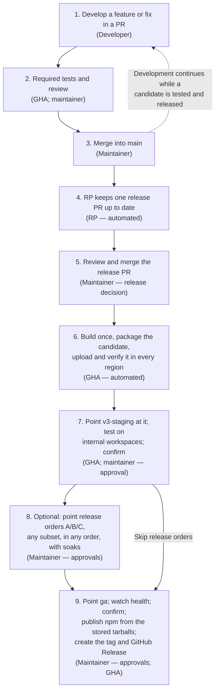
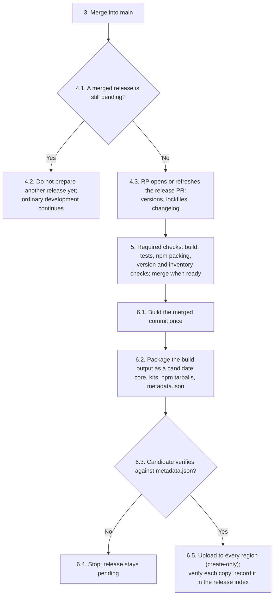
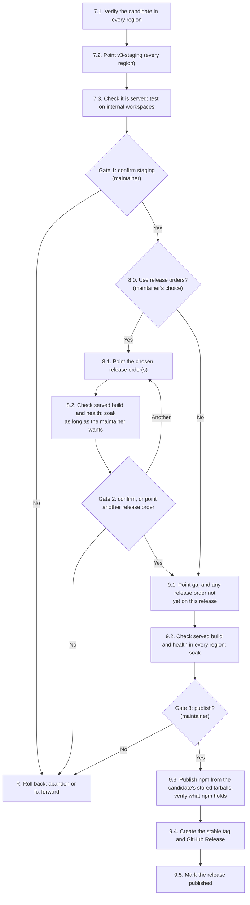
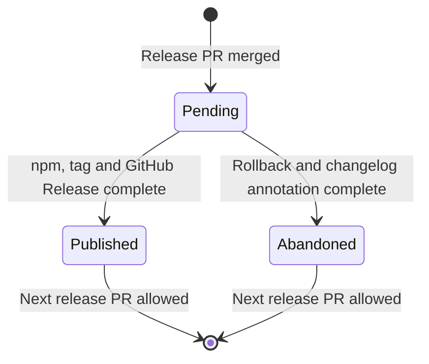

# V3 trunk development and S3 release delivery

Updated 2026-10-15. This describes the target process. Parts of it already run in
shadow mode, alongside the current branch-based release; see
[Where we are now](#where-we-are-now).

Our goal is to align mParticle's development and release process with Rokt's as
much as practical, reducing the cognitive load of working across the two SDKs.
Developers should have a familiar way to merge changes, prepare a build, test it,
and promote it to production. We will keep GitHub Actions and account for
mParticle's public repository, semantic versions, and npm packages while adopting
the shared practices of trunk development and promoting a specific tested build.

## Why we are changing the development and release process

**Development is coupled to delivery.** The SDK delivery service pulls the v3
distribution files from release branches in this repository, for example
[`main/dist/mparticle.js`](https://github.com/mParticle/mparticle-web-sdk/blob/main/dist/mparticle.js).
Release builds add generated-file commits, and changes to those files can reach
customers. Letting development continue while a release is tested therefore
requires coordinating release commits and branch freezes.

**Delivery depends on the GitHub API.** The delivery service refreshes the v3 core
and kit files every 5 minutes in every region by calling the GitHub API. Server
logs for the week of 2026-09-18 to 2026-09-25 show, approximately:

| Failure                                      | Approximate volume                  |
| -------------------------------------------- | ----------------------------------- |
| GitHub API rate-limit failures (core + kits) | 600–960 per day in each environment |
| 404 responses caused by a kit path bug       | 500–670 per day in each region      |

The service falls back to previously cached copies, so customers are not served
broken code. However, updates can be delayed or skipped, and every release depends
on a third-party API's rate limits.

**The release can fail after it has shipped.** Today npm publishing happens in the
first release step. A kit that npm refuses, or that npm reports as failed after
accepting it, fails a release whose code is already on its way to customers.

## The approach

-   Merge features and fixes into `main`, the development trunk, continuously.
-   [Release Please](https://github.com/googleapis/release-please-action) (RP)
    keeps one release PR open with the changelog and version bumps for core and
    kits, and refreshes it as changes merge.
-   Merging the release PR builds the release **once**. That build is packaged as
    an immutable **candidate** (CDN files and npm tarballs) and uploaded to every
    region's storage bucket. It is never rebuilt.
-   Each delivery **channel** has a small pointer file, `active-release.json`, that
    selects a candidate. Releasing, and rolling back, means changing pointers.
    Merges to `main` never change what customers are served.
-   npm, the stable tag, and the GitHub Release come **last**, once the release is
    live everywhere and healthy. npm gets the exact tarballs that were tested.

The S3 delivery change covers unpinned v3 core with kits. V2, `stub.js`, and
distribution files referenced by tagged versions keep their existing delivery
paths; see [Compatibility](#compatibility).

## 1. Development and release overview



Steps **1–9** are reused below with substeps such as **6.2**. **R** is rollback.

## 2. Release PR and candidate (Steps 3–6)



-   **One build per release (6.1–6.2).** The candidate packages exactly what the
    release build produced. An earlier attempt to rebuild the captured source
    separately did not reproduce the released bytes, because of source-map
    comments, nondeterministic output from the legacy Rollup CommonJS plugin,
    file modes, and gzip differences.
    [#1490](https://github.com/mParticle/mparticle-web-sdk/pull/1490) fixed the
    nondeterministic kit builds. Packaging is deterministic, and a parity run
    against the v3.11.1 release matched every bundle and tarball.
-   **npm tarballs are part of the candidate (6.2).** The packager packs the npm
    tarball for the core and every kit into the candidate's `npm/` folder and
    records each one's npm integrity in `metadata.json`. The uploader refuses a
    tarball whose bytes do not match. They are stored with the CDN files, so they
    do not expire the way CI artifacts do, and the final step publishes these
    exact files.
-   **Release PR boundary (5).** The release PR stays open and RP refreshes it as
    changes merge. Before merging it, the release owner confirms it includes
    everything on `main` and that the required checks pass. Merging it fixes the
    candidate; later merges belong to the next release.
-   **Version rules (4.3).** Versions are calculated from the last published
    release, not from an earlier unmerged proposal. Required checks verify that
    every publishable package is covered by RP's version-update configuration, so
    a newly added package cannot keep an old version. Compatible dependency
    ranges are kept unless a compatibility change needs them updated, and a
    release never requires an unpublished npm dependency. RP's configuration
    ([#1528](https://github.com/mParticle/mparticle-web-sdk/pull/1528)) keeps
    today's bump rules, except that `build` no longer cuts a release:
    -   `feat` proposes a minor release. `fix`, `perf`, `revert`, `chore`, `ci`,
        `docs`, `test`, `refactor` and `style` propose a patch.
    -   `build` is hidden, so a toolchain or dev-dependency bump alone does not
        release every package. Production dependency bumps use `fix(deps)`.
    -   A breaking change proposes a major release, whatever its type.
    -   The changelog has Features, Bug Fixes, Performance Improvements and
        Reverts sections; the other types are listed under "Miscellaneous".
-   **Release index (6.5).** Each uploaded candidate is recorded under
    `releases/<version>.json`, so every later step and every rollback is chosen
    **by version**; the build is looked up, not inferred from branch moves or run
    titles ([#1601](https://github.com/mParticle/mparticle-web-sdk/pull/1601)).

## 3. Release: activate the candidate channel by channel (Steps 7–9)

The **Release** workflow takes a version, looks up its candidate in the release
index, and moves it through the channels. Each move is a pointer change, followed
by a gate.



**Channels.** The delivery service already assigns each workspace a release-order
value. That value is the channel, so no assignments need to be migrated.

| Channel              | Serves                                                   |
| -------------------- | -------------------------------------------------------- |
| `v3-staging`         | The canary: internal test workspaces assigned to staging |
| `v3-release-order-a` | Workspaces in release order A                            |
| `v3-release-order-b` | Workspaces in release order B                            |
| `v3-release-order-c` | Workspaces in release order C                            |
| `ga`                 | Every workspace without a release-order value            |

The default channel is `ga` ("general availability"), not `production` or
`main`: `production` collides with the environment meaning (production vs QA),
and `main` would tie a storage channel to a git branch name.

**Release orders are optional, and their use is a maintainer's call (8).** They
let us soak one customer and not another, try a release with a customer first,
or roll out slowly. The process does not require them, does not fix their order,
and does not require a soak between them. Step 9 always brings every channel to
the release, whether or not release orders were used.

**Kits follow the channel with the core.** Today only the core bundle follows the
release order; kits come from `main` for every channel. With candidates, a
workspace gets its channel's core and kits together.

**Gates.** A gate is the checkpoint between two steps. A maintainer decides at
every gate; nothing advances by itself. Each gate's run summary shows the
evidence, so the approver reads one page instead of searching logs:

1.  **Pointers:** a `status` read of every channel in every region
    ([#1603](https://github.com/mParticle/mparticle-web-sdk/pull/1603)), showing
    the expected build.
2.  **Delivery:** for the channel just moved, in every region, the delivery
    service reports serving the new build from storage. A delivery failure is any
    of:
    -   a region not serving the new build after a few cache refreshes, either
        still on the old build or falling back;
    -   sustained fallbacks such as kits unavailable, an invalid candidate or
        repeated storage timeouts (one timeout on one host is not a failure);
    -   pointers not where the release put them;
    -   rising errors or failed `/js/v3` responses from the delivery service.
3.  **Unknown is not healthy:** if the check gets no data, its queries fail, or
    it times out, the summary says "unknown". It does not block a maintainer from
    advancing, but it is never shown as a pass.

`v3-staging` traffic is internal and small, so Gate 1 is a human test plus the
delivery check. Health measurements are meaningful for release orders and `ga`.
This follows Rokt's web SDK release: confirm the new build is served before
measuring anything, fail closed, and never treat missing data as a pass. Unlike
Rokt's, our rollback is one pointer write, not a redeploy.

**npm last (9.3).** npm is the only step that cannot be undone: a pointer
rollback takes seconds, while a published npm version can only be deprecated and
rolled forward. So npm waits until `ga` has soaked and Gate 3 is approved.

-   The workflow downloads the candidate's tarballs, re-checks each against
    `metadata.json`, and runs `npm publish` on those exact files. npm and CDN users
    get byte-for-byte what was tested.
-   **Success is decided by what npm holds**, not by `npm publish`'s exit code.
    npm can report a failure after it has accepted a package. A package counts as
    published once npm shows its version with the candidate's integrity under the
    expected dist-tag. Only packages npm still does not have are published again;
    a version can be published only once, so an existing one is never replaced.
-   A partial publish is resumed with the same tarballs. Nothing is rebuilt.

**Tag and GitHub Release last (9.4).** The candidate records its source commit
from the start, but the public `vX.Y.Z` tag and release notes are created only
once the release is public everywhere. A version rolled back at staging was never
released, so it gets no tag. The workflow resolves the last published v3 release,
checks that its tag is an ancestor of the candidate's commit, and passes it as the
start of the generated release notes; this matters in a repository that also has
v2 tags. Before a retry, an existing tag is reused only if it points at the
candidate's commit, and an existing GitHub Release only if it is for that tag.

**Not atomic.** Any failed write, cancellation, or rejected approval stops the
run. Ending a run does not undo pointer changes already made: check `status`,
then finish the release or roll the affected channels back. Storage
read-after-write consistency does not mean the delivery service and CDN caches
have finished refreshing, which is why every gate checks what is served.

## 4. Rollback, status, and repair

**Rollback** is its own workflow, separate from Release and fast:

-   It takes a version and the channels to restore: one, several, or **all**
    (`rollback-all`). The build comes from the release index.
-   It needs no npm, no soak, and no approval chain.
-   It verifies the target candidate's files in every region before writing.
-   By default a rollback refuses to move a channel forward, or onto another
    build of the same version. A single-channel rollback can override this with
    `--allow-upgrade` (to undo a rollback) or `--allow-rebuild`, and needs
    `--allow-downgrade` to move a channel to an older release
    ([#1602](https://github.com/mParticle/mparticle-web-sdk/pull/1602)).
-   `rollback-all` takes `--allow-downgrade` and `--allow-rebuild` but never
    `--allow-upgrade`: it moves `v3-staging` first, then `ga`, then release orders C, B
    and A, so most workspaces come before fewer. A channel already on an older
    release is left alone and reported. It stops at the first failure, reports
    what moved, and re-checks every channel afterwards; a re-run converges.
    In today's shadow workflows, which have no shared lock, stop further Step 2
    and 3 runs before a `rollback-all`: its re-check cannot catch a promotion
    write that lands after it. The end-state lock below removes this precondition.
-   It records each pointer move it makes.
-   It changes only what the delivery service serves. It does not undo npm, and
    does not change stubs or pinned versions.

**Status** is read-only and safe at any time. It shows what every channel serves
in every region and flags drift. Before cutover, a scheduled reconciliation run
does the same check and emits a heartbeat monitored outside it, so a missing run
is noticed rather than read as healthy. We also measure and set a rollback
objective: the time from starting a rollback until the restored build is
confirmed served in every affected region.

**Repair** is rare: re-running a step that failed part-way, such as a missed
upload, with the same candidate.

**One lock for every pointer change.** Release, Rollback and Repair share one
concurrency group, without cancelling runs in progress, so a rollback can never
race a promotion. Every pointer write is also conditional on the value read
before it, so a stale writer fails instead of overwriting a newer selection.
GitHub keeps only one waiting run per group: a third request arriving while two
are queued cancels the earlier waiting one. Nothing is corrupted, but a cancelled
request has to be run again.

**What a maintainer sees:** four workflows. **Release** (one run, with the gates
inside it), **Rollback**, **Status**, and **Repair**. Release Please handles
versioning, and all CI stays automatic.

### Release state and recovery

The release PR records state with `release: pending`, `release: published`, or
`release: abandoned` labels, which are authoritative for this process rather than
RP's `autorelease:*` labels. A failed or cancelled run stays pending; it never
publishes or abandons a candidate by itself. Features may keep merging into
`main`, but another release PR cannot be prepared until the current candidate
reaches a terminal state.



-   **An upload or pointer write fails, but the build is good:** retry with the
    stored candidate. There is nothing to rebuild.
-   **Testing finds a bug before npm:** roll back, abandon the version, merge the
    fix, and release a new version.
-   **Some npm packages publish and others fail:** npm is checked, and only the
    missing packages are published again from the same tarballs. If code must
    change, use a new version.
-   **The tag or GitHub Release fails after npm:** create only what is missing,
    and stop for review on any mismatch.
-   **A problem appears after npm:** the version is installable, so it cannot be
    abandoned. Roll the affected channels back, keep it `release: published`, and
    fix forward with a new version.

**Abandoning a rejected candidate.** A candidate may be marked abandoned only
after no channel selects it and the restored build is verified. The workflow
then opens an automated PR that changes its changelog heading, for example to
`## [3.6.0] — abandoned, never published`, merges it through the normal checks,
and replaces `release: pending` with `release: abandoned`, which lets RP prepare
the successor. Rejected versions are never reused, so gaps in npm versions and
tags are expected. The successor's release notes cover everything since the last
published v3 tag.

## 5. Storage

Candidates and pointers live in the existing per-region SDK storage buckets, with
identical keys in every region:

```text
web-sdk/v3/
├── candidates/<version>/<buildId>/        # immutable, create-only
│   ├── core/dist/...
│   ├── kits/<kit>/dist/...
│   ├── npm/*.tgz
│   ├── cdn-bundles.tgz
│   └── metadata.json                      # written last
├── releases/<version>.json                # release index: the build for each version
└── channels/<channel>/active-release.json # small mutable pointer; conditional writes only
```

`metadata.json` is written last, so a candidate without it is incomplete and is
never promoted. It records the source commit, build identity, and the inventory
and checksums of every core, kit, and npm artifact.

A pointer:

```json
{
    "schemaVersion": 1,
    "version": "3.5.0",
    "buildId": "12345-1",
    "candidatePrefix": "web-sdk/v3/candidates/3.5.0/12345-1/",
    "metadataSha256": "<SHA-256 of the exact uploaded metadata.json bytes>"
}
```

-   `schemaVersion` lets the reader reject a format it does not support.
-   `version` is shared by core and kits; `buildId` is the GitHub Actions run ID
    and attempt that built it.
-   `candidatePrefix` must be exactly `web-sdk/v3/candidates/<version>/<buildId>/`,
    using the pointer's own `version` and `buildId`.
-   `metadataSha256` is computed from the exact uploaded bytes; the reader verifies
    the downloaded bytes before parsing them.

Writing one small pointer is atomic; uploading a directory is not. A pointer to a
complete, unique candidate lets the delivery service load core and kits from the
same build, and makes rollback a single write.

Object headers:

| Object                    | `Content-Type`                          | `Cache-Control`                       |
| ------------------------- | --------------------------------------- | ------------------------------------- |
| JavaScript                | `application/javascript; charset=utf-8` | `public, max-age=31536000, immutable` |
| Source maps, metadata     | `application/json`                      | `public, max-age=31536000, immutable` |
| Tarballs                  | `application/gzip`                      | `public, max-age=31536000, immutable` |
| `active-release.json`     | `application/json`                      | `no-cache`                            |
| `releases/<version>.json` | `application/json`                      | `no-cache`                            |

No object sets `Content-Encoding`. Files are stored as raw bytes so their SHA-256
matches `metadata.json`. Integrity is checked with bytes, size, and SHA-256,
never the ETag; the ETag is only the precondition for conditional pointer writes.

**Retention.** Each candidate keeps its complete artifacts in its own location;
overwriting one could expose a mixture of files and erase the build needed for
rollback. Proposed policy, to confirm before any cleanup is built: keep every
candidate any channel selects in any region, plus those in active releases or
unresolved recovery and each channel's last-known-good build; delete others after
a retention window, initially 30 days. Cleanup must re-check pointers before
deleting and share the pointer lock. No blanket or unconditional age-based
expiration rule applies to candidates, because an old build may still be serving a release order.

## 6. Identities and regions

Each job uses its own identity with only the access it needs:

| Identity           | Access                                                             |
| ------------------ | ------------------------------------------------------------------ |
| Uploader           | Create-only on `candidates/` and the release index                 |
| Promoter           | Conditional writes on `channels/` only; reads candidates to verify |
| Server-side reader | Read-only                                                          |
| Legacy writer      | Fenced out of `web-sdk/` by policy                                 |
| Retention          | Separate identity, used only for cleanup                           |

Workflows use short-lived GitHub OIDC credentials only; there are no long-lived
keys. Credentialed jobs run as reusable workflows pinned through the OIDC
`job_workflow_ref` claim, in GitHub Environments that only `main` can use.
Who may run each workflow is limited by team, not by a per-run approval:
releases need the maintainer gates above, while a rollback can be run at once
by anyone on the SDK team, as in Rokt's web SDK, where fast rollback has no
approval step. Workflow changes and `CODEOWNERS` require designated review.

Each region's delivery service reads its own region's bucket, as it does today.
Every production region runs in a separate cloud account with its own OIDC
identity provider, roles, and bucket policy, so the pipeline uploads each
candidate to every region and the promoter updates each region's pointer.

## 7. SDK delivery service

The delivery service reads candidates through a reader that is deployed switched
off. Each channel has its own mode:

| Mode      | Behavior                                                  |
| --------- | --------------------------------------------------------- |
| `off`     | Serve from GitHub, as today                               |
| `compare` | Serve from GitHub; also read S3 and report any difference |
| `s3`      | Serve from S3                                             |

-   A channel moves to `s3` only after a verified candidate exists for it in that
    region.
-   In `s3` mode, a failed read falls back to GitHub, then to the backup copy.
    After cutover, each region is bootstrapped with a verified last-known-good
    candidate; if the selected candidate cannot be loaded, the service keeps
    serving that build rather than an incomplete core and kit set.
-   The reader validates the complete core and kit set and builds its replacement
    cache before switching, so it never serves a partially loaded candidate.
-   Kits follow the core, channel by channel.

## Where we are now

The branch-based release (Steps 1–3 on `v3-development`, `v3-staging`,
`v3-release-order-a/b/c` and `main`) stays authoritative until cutover. The
candidate pipeline runs alongside it in **shadow mode**:

-   Step 1 runs a shadow packaging job after a real release
    ([#1511](https://github.com/mParticle/mparticle-web-sdk/pull/1511)).
-   Shadow upload and pointer workflows run from the default branch after Steps
    1–3 and mirror each branch move as a pointer move
    ([#1525](https://github.com/mParticle/mparticle-web-sdk/pull/1525),
    [#1527](https://github.com/mParticle/mparticle-web-sdk/pull/1527),
    [#1535](https://github.com/mParticle/mparticle-web-sdk/pull/1535),
    [#1610](https://github.com/mParticle/mparticle-web-sdk/pull/1610)).
    Automatic shadow runs act only on the regions listed in a repository
    variable; a manual dispatch can choose any configured set of regions.
-   Uploads are create-only, pointer writes are conditional, and a stale or
    out-of-order run cannot move a channel to an older release.
-   During shadow, the candidate must match the git release (a blocking check).
    npm not yet showing the release, or npm being unavailable, is advisory; a
    visible npm integrity difference blocks the upload.
-   Rollback by version, the rollback flags and `status` have merged
    ([#1601](https://github.com/mParticle/mparticle-web-sdk/pull/1601)–[#1603](https://github.com/mParticle/mparticle-web-sdk/pull/1603)).
-   The delivery service's `compare` mode has been proven in QA.

The shadow workflows mirror today's branch-based steps on purpose. They are
scaffolding: at cutover the four end-state workflows replace them and the release
branches, rather than being migrated.

### Current branches to target channels

| Current v3 mechanism                 | Target                            |
| ------------------------------------ | --------------------------------- |
| `v3-development`                     | `main`, the development trunk     |
| `v3-staging` branch                  | `channels/v3-staging` pointer     |
| `v3-release-order-a/b/c` branches    | `channels/v3-release-order-a/b/c` |
| `main/dist` as the production source | `channels/ga` pointer             |
| Steps 1–3                            | Release, Rollback, Status, Repair |

When the channels are served from storage everywhere, the release branches are
deleted from GitHub; pointers are the only record of what each channel serves.

## Incremental implementation plan

| Increment                         | Scope                                                                                            | Exit evidence                                                                            | State       |
| --------------------------------- | ------------------------------------------------------------------------------------------------ | ---------------------------------------------------------------------------------------- | ----------- |
| 1. Validate artifact storage      | Upload, read back and verify a candidate without activating it                                   | Repeatable upload and checksum verification                                              | Done        |
| 2. Shadow candidates and pointers | Package every release; upload and mirror pointers in shadow; rollback by version; `status`       | Every release mirrored; pointers match the branches                                      | In progress |
| 3. Serve from storage             | Move each channel and region from `compare` to `s3`, core first, then kits                       | Every channel in every region served from storage; GitHub no longer on the delivery path | In progress |
| 4. End-state workflows            | Release (gates, evidence summaries, npm last), Rollback, Status, Repair; one pointer lock        | A release run end to end in QA, including rollback and a resumed npm publish             | Not started |
| 5. Trunk cutover                  | RP release PR; `main` as the trunk; delete release branches and the shadow layer                 | Merges to `main` cannot change what customers are served; no routine merge freezes       | Not started |
| 6. Retire compatibility outputs   | Migrate or deprecate `main/dist`, `stub.js` and tagged-version consumers; stop committing `dist` | Supported consumers use their replacement path; no generated artifacts on `main`         | Not started |

RP can be tested independently. Its dry run must cover the recovery case: merge a
release PR, merge more changes while its candidate is pending, roll it back, merge
the abandoned-changelog annotation, and verify RP proposes the expected successor
version, commit range, manifest and changelog.

## Compatibility

-   **V2** continues to be served as today. This design covers v3 only.
-   **`stub.js` and tagged versions** keep their existing delivery paths until a
    separate compatibility migration (increment 6). Until then, any compatibility
    `dist` files are generated from the approved candidate and treated as
    non-authoritative.
-   **Version pinning** (`?mp_sdk=`) through storage is deferred. Current usage
    cannot be measured with existing telemetry, and the current v3 pin lookup is
    limited to recent tags. The proposal is an immutable per-version pointer
    written when a release reaches `ga`. We will add a request counter first and
    decide with data. Until then, a v3 pin request falls back to the workspace's
    channel.

## Decisions

-   **One build per release**; the candidate is never rebuilt, and npm publishes
    its stored tarballs.
-   **npm, the stable tag and the GitHub Release come last**, after `ga` has
    soaked and a maintainer approves. npm success is decided by what npm holds.
-   **Release orders are optional and unordered**; using them is a maintainer's
    decision per release.
-   **Every gate is a maintainer decision**, backed by an evidence summary.
    Missing data is "unknown", never a pass.
-   **Steps take a version**; the build comes from the release index.
-   **Rollback is a separate, fast workflow** for any set of channels, with no npm
    or per-run approval (it is limited to the SDK team), and never moves a
    channel forward by default.
-   **One shared lock** for every pointer change.
-   **Channels are pointers only**; release branches are deleted at cutover.
-   **Rejected versions are never reused**; npm and tag gaps are expected.
-   **Channel names** are `v3-staging`, `v3-release-order-a/b/c` and `ga`.

## Open questions

-   **Customer-health signal:** delivery failures can be measured today. Which
    signal shows that the new SDK code misbehaves for customers? The leading
    candidate is event volume from the affected workspaces compared with the hour
    before the move, now reporting the new SDK version. The data source needs
    confirming before thresholds are set.
-   **Automatic rollback:** should a failed health check after a release order or
    `ga` move put the pointer back by itself? Initially no: rollback stays a
    maintainer decision until the check has been watched on real releases.
-   **Soak before npm:** how long `ga` soaks before Gate 3, for example 24 hours
    or until the health check is clean.
-   **Access sign-off:** limiting the workflows by team instead of requiring a
    reviewer on each run still needs security sign-off.
-   **Partial promotion:** how to handle a pointer move that succeeds in some
    regions but not others, beyond reporting it and re-running.

### Deferred

-   **Pointer `channel` field:** optional in schema 1: accepted when present,
    never written. A pointer that names a different channel is rejected.
-   **Retention:** how long candidates and pointer history are kept is set
    before cleanup is built.
-   **Version pinning:** decided with data from the request counter (see
    [Compatibility](#compatibility)).
